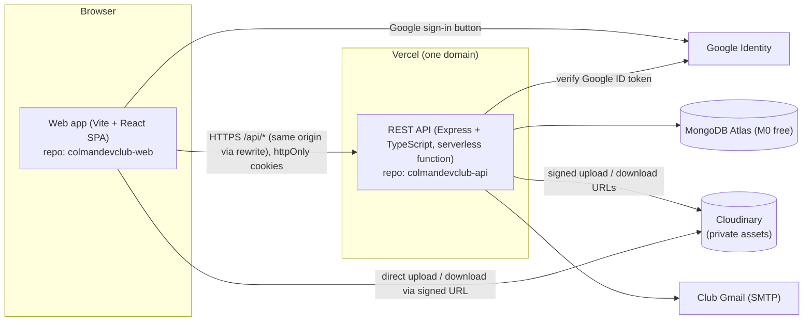
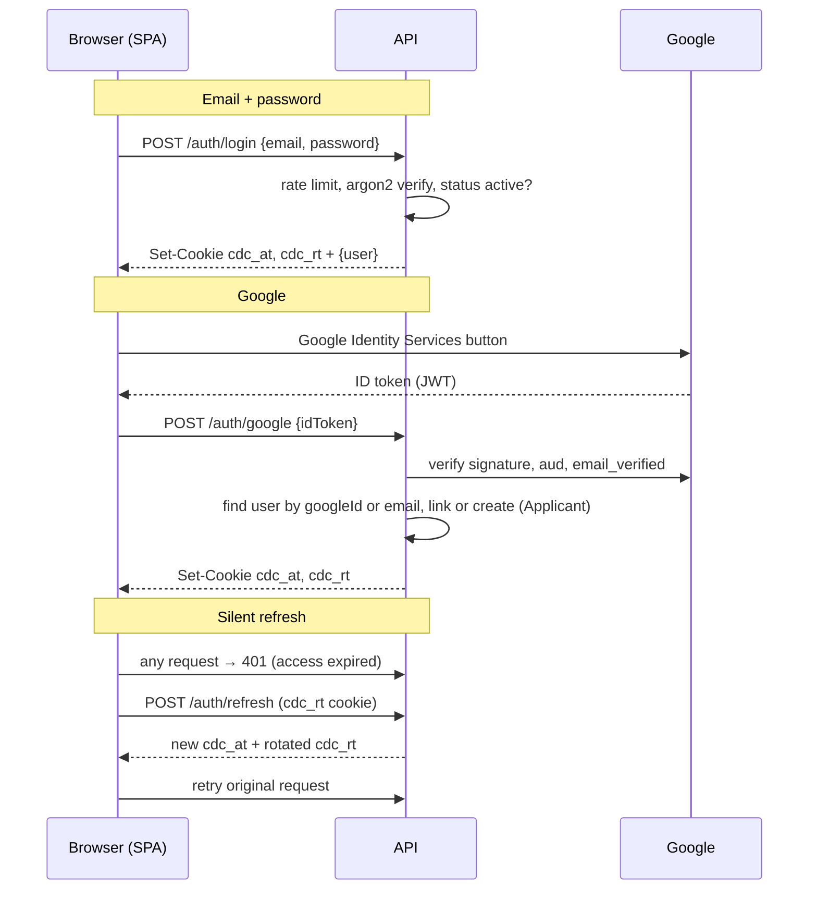

# ColmanDevClub Website — Technical Design

|                   |                                                                                                                                   |
| ----------------- | --------------------------------------------------------------------------------------------------------------------------------- |
| **Status**        | Draft v0.4                                                                                                                        |
| **Date**          | 2026-11-14                                                                                                                        |
| **Method**        | Spec-Driven Development (SDD): **phase 2, design**                                                                                |
| **Implements**    | `REQUIREMENTS.md` **v1.1 (approved)** (requirement IDs `R-xx`, requirement decisions `Dxx`)                                       |
| **Next artifact** | `tasks.md`: implementation plan, each task traced to `R-xx` and to a section of this document                                     |
| **Visual design** | Claude Design artifact "ColmanDevClub — Website" (D18). This document covers the technical design. The visual design lives there. |

### Rules for this document

1. Every design element traces to at least one requirement ID. Anything that traces to none is either removed or added to the requirements first.
2. Technical decisions are logged in §2 as `T-xx`, with their reason and the alternatives considered.
3. Undecided items are listed in §17 (open items). Code depends on interfaces (§10, §11), so those decisions don't block development.

---

## 1. Architecture overview



- **Web app:** a static single-page app on Vercel. All pages render in the browser. `index.html` carries the site-wide meta tags (R-06, D25).
- **Same origin:** the web project's `vercel.json` rewrites `/api/*` to the API project, so the browser only ever talks to one domain: no CORS, first-party cookies (T-19).
- **API:** a stateless Express app, deployed as a Vercel serverless function. It owns all business rules and every permission check (R-12). Locally it runs as a normal `node` server.
- **Database:** MongoDB Atlas.
- **Files:** never pass through the database. The API hands out short-lived signed URLs (R-19.3).

---

## 2. Technical decisions

| ID   | Decision                                                                                                                                                                                                                                                                                                                | Reason                                                                                                                                                                                                                            | Alternatives considered                                                                                                                             | Traces to            |
| ---- | ----------------------------------------------------------------------------------------------------------------------------------------------------------------------------------------------------------------------------------------------------------------------------------------------------------------------- | --------------------------------------------------------------------------------------------------------------------------------------------------------------------------------------------------------------------------------- | --------------------------------------------------------------------------------------------------------------------------------------------------- | -------------------- |
| T-01 | **Vite + React 19 + TypeScript SPA**                                                                                                                                                                                                                                                                                    | Team knows it from Sagol360. One shared link preview is acceptable (D25).                                                                                                                                                         | Next.js; React Router 7 prerender                                                                                                                   | R-06                 |
| T-02 | **React Router 7** (library mode)                                                                                                                                                                                                                                                                                       | Already used in Sagol360                                                                                                                                                                                                          | TanStack Router                                                                                                                                     | all screens          |
| T-03 | **Tailwind CSS + shadcn/ui** (Radix primitives)                                                                                                                                                                                                                                                                         | Design tokens map directly to Tailwind. Accessible primitives for dialogs, selects, tabs and toasts. Doesn't look like a generic template.                                                                                        | MUI 7                                                                                                                                               | R-34, R-37, R-42     |
| T-04 | **TanStack Query + axios**                                                                                                                                                                                                                                                                                              | Caching, loading and error states                                                                                                                                                                                                 | Hand-written fetch                                                                                                                                  | R-37.1               |
| T-05 | **react-hook-form + zod**                                                                                                                                                                                                                                                                                               | Form state plus schema validation                                                                                                                                                                                                 | Formik, Yup                                                                                                                                         | R-04.3, R-10.2       |
| T-07 | **Motion** (`motion` package) + CSS transitions                                                                                                                                                                                                                                                                         | Page and section animation with `useReducedMotion`                                                                                                                                                                                | GSAP                                                                                                                                                | R-35                 |
| T-08 | **Express 5 + TypeScript** API                                                                                                                                                                                                                                                                                          | Team experience                                                                                                                                                                                                                   | NestJS, Fastify                                                                                                                                     | —                    |
| T-09 | **MongoDB + Mongoose**                                                                                                                                                                                                                                                                                                  | Team experience, Atlas free tier                                                                                                                                                                                                  | Postgres                                                                                                                                            | —                    |
| T-10 | **JWT in httpOnly cookies**: 15-minute access token + 30-day rotating refresh token                                                                                                                                                                                                                                     | JavaScript can't read the token (XSS-safe). Refresh tokens can be revoked. Users stay signed in for 30 days.                                                                                                                      | localStorage + Bearer header                                                                                                                        | R-07, R-12, R-44     |
| T-11 | **Two repositories**: `colmandevclub-web`, `colmandevclub-api`                                                                                                                                                                                                                                                          | Team decision                                                                                                                                                                                                                     | Monorepo                                                                                                                                            | —                    |
| T-12 | **Zod schemas duplicated** in both repos. The API's copy is the authoritative one.                                                                                                                                                                                                                                      | No shared-package overhead                                                                                                                                                                                                        | Shared npm package, OpenAPI codegen                                                                                                                 | R-04.3               |
| T-13 | **Tooling:** pnpm, ESLint, Prettier, Husky + lint-staged, Vitest, GitHub Actions PR checks                                                                                                                                                                                                                              | Copied from Sagol360                                                                                                                                                                                                              | —                                                                                                                                                   | —                    |
| T-14 | **Passwords hashed with argon2id**                                                                                                                                                                                                                                                                                      | Current best practice                                                                                                                                                                                                             | bcrypt                                                                                                                                              | R-07, R-44           |
| T-15 | **Cloudflare Turnstile** + rate limiting + honeypot field on public forms                                                                                                                                                                                                                                               | Free, no puzzles for real users                                                                                                                                                                                                   | reCAPTCHA                                                                                                                                           | R-04.7               |
| T-16 | **Node.js 22 LTS** in CI and runtime                                                                                                                                                                                                                                                                                    | Current LTS                                                                                                                                                                                                                       | Node 20                                                                                                                                             | —                    |
| T-17 | **No i18n library.** Hebrew strings live in the components.                                                                                                                                                                                                                                                             | Second language is out of scope (D26)                                                                                                                                                                                             | i18next                                                                                                                                             | R-38                 |
| T-18 | **Fonts self-hosted:** IBM Plex Sans Hebrew + JetBrains Mono, subset, `font-display: swap`                                                                                                                                                                                                                              | Performance, no layout shift                                                                                                                                                                                                      | Google Fonts CDN                                                                                                                                    | R-41                 |
| T-19 | **Hosting: Vercel for both web and API** (Hobby, free). Web rewrites `/api/*` to the API project.                                                                                                                                                                                                                       | Free; one origin removes cross-site cookie and CORS complexity                                                                                                                                                                    | Render (free tier sleeps 30–60 s), AWS                                                                                                              | R-44.1               |
| T-20 | **MongoDB Atlas M0** (free, 512 MB), connection cached across serverless invocations                                                                                                                                                                                                                                    | Free; standard serverless pattern avoids exhausting connections                                                                                                                                                                   | Larger Atlas tier                                                                                                                                   | —                    |
| T-21 | **File storage: Cloudinary** (free plan, account on the club Gmail; private/authenticated assets, signed direct uploads, short-lived signed download URLs; **max 10 MB per file**)                                                                                                                                      | Owner-confirmed and already set up in S-0.5 (KAN-14). Free, no card. Signed uploads and downloads bypass the API, so Vercel's ~4.5 MB body limit doesn't apply. 10 MB is the free plan's per-file limit for images and raw files. | Supabase Storage (chosen in v0.2, replaced in v0.4), Google Drive (no signed URLs; downloads would hit the body limit), Cloudflare R2 (card needed) | R-18.4, R-19.3       |
| T-22 | **Email: club Gmail over SMTP** via nodemailer + app password (~500/day)                                                                                                                                                                                                                                                | Free, sends from the club's real address, enough volume                                                                                                                                                                           | Resend (needs a domain), SendGrid                                                                                                                   | R-04.4, R-08, R-13.1 |
| T-23 | **API docs: OpenAPI 3.1 generated from the zod schemas** (`@asteasolutions/zod-to-openapi`), Swagger UI at `/api/docs` (local and preview only, off in production). Every route registers its schemas, auth, policy and R-IDs in `src/docs/`; CI runs `pnpm docs:check`, which fails on missing or stale registrations. | One contract both repos can read, generated from the authoritative schemas (T-12), so it can't drift. Done in S-0.12 (KAN-62).                                                                                                    | Hand-written OpenAPI file, no API docs                                                                                                              | T-12, R-12           |
| T-24 | **CodeRabbit automated PR review** (`.coderabbit.yaml` in both repos, `assertive` profile, project rules as path instructions). It comments only and never approves or requests changes.                                                                                                                                | Catches rule violations (secrets, PII in logs, RTL classes, missing policies) before a human reviews. Done in S-0.13 (KAN-63).                                                                                                    | No automated review, GitHub Copilot review                                                                                                          | T-13                 |
| T-25 | **Review and merge rule:** `main` protected; a PR needs green CI and one approval from a lead in CODEOWNERS (`@Lavi2910`, `@Elad-Abutbul`); the author merges. PR title starts with the Jira key, and the PR template asks for R-IDs.                                                                                   | Lightweight for a student team, with one accountable reviewer per PR. Done in S-0.3 (KAN-12).                                                                                                                                     | Two approvals, merge queue                                                                                                                          | T-13                 |

---

## 3. Repositories

### 3.1 `colmandevclub-web`

```
src/
  app/                 # router, providers (QueryClient, auth), layouts
  pages/
    public/            # Home, Mentors, Join, SignIn, SignUp, VerifyEmail, ForgotPassword, ResetPassword, AcceptInvite
    applicant/         # ApplicationStatus
    member/            # MemberHome, MaterialsLibrary
    account/           # Profile (incl. delete account)
    dashboard/         # Overview, Curriculum, Materials, ImportFromYear, Members, MemberDetail,
                       # Absences, Applicants, AssessmentDays, Years, Users, Settings
    errors/            # NoAccess (403), NotFound
  components/
    ui/                # shadcn/ui components, restyled with the design tokens
    layout/            # SiteHeader, SiteFooter, DashSidebar, DashTopbar, AccountMenu
    shared/            # EmptyState, Skeletons, StatusPill, WeekChip, ConfirmDialog, UndoToast
  features/            # per-domain hooks + API calls (auth, years, weeks, materials, members, absences, admissions, users)
  schemas/             # zod schemas (copy of the API's, T-12)
  content/             # static public content: showcase projects, legacy mentors, social links (D23)
  lib/                 # axios client, query keys, date helpers, bidi helpers
  styles/              # tailwind.css, tokens
vercel.json            # rewrites: /api/* → API project; SPA fallback to index.html
index.html             # site-wide <title>, description, Open Graph / Twitter tags (R-06.1)
```

### 3.2 `colmandevclub-api`

```
src/
  app.ts               # express app: middleware chain (§6.1)
  server.ts            # local: app.listen()
  config/              # env parsing (zod), constants
  modules/
    auth/              # signup, login, google, refresh, logout, verify, reset, invites
    users/             # profile, admin user management, self-delete
    years/             # academic years, mentor assignment, year membership
    weeks/             # curriculum
    materials/         # materials, upload/download URLs, views, import from earlier years
    tracking/          # absences, member status, notes, overview, members list
    admissions/        # assessment days, form options, applications, evaluations
    search/
    audit/
    public/            # unauthenticated read endpoints
  middleware/          # authenticate, authorize, validate, rateLimit, csrf, errorHandler
  services/
    storage/           # StorageService interface + Cloudinary adapter + local adapter (§10)
    email/             # EmailService interface + Gmail SMTP adapter + console adapter + templates (§11)
    google/            # ID-token verification
  models/              # Mongoose models (§8)
  policies/            # permission functions (§7)
  schemas/             # zod schemas: source of truth (T-12)
tests/
  integration/         # supertest + mongodb-memory-server
api/index.ts           # Vercel entry: exports the Express app
vercel.json
```

Each module contains `*.routes.ts`, `*.controller.ts` (HTTP only), `*.service.ts` (business rules) and `*.test.ts`.

---

## 4. Frontend design

### 4.1 Routes

| Route                                                  | Screen (Claude Design board)                               | Access                                                                | Requirements     |
| ------------------------------------------------------ | ---------------------------------------------------------- | --------------------------------------------------------------------- | ---------------- |
| `/`                                                    | Home (Main)                                                | Everyone                                                              | R-01, R-02, R-05 |
| `/mentors`                                             | Mentors directory                                          | Everyone                                                              | R-03             |
| `/join`                                                | Assessment-day registration, or the "no open days" variant | Guest, Applicant                                                      | R-04             |
| `/signin`, `/signup`                                   | Auth                                                       | Guest                                                                 | R-07             |
| `/verify-email`, `/forgot-password`, `/reset-password` | Auth states                                                | Guest                                                                 | R-08             |
| `/invite/:token`                                       | Accept invite (sign-up with role preset)                   | Guest                                                                 | R-07.3, R-13.1   |
| `/application`                                         | Applicant status                                           | Applicant                                                             | R-09             |
| `/my`                                                  | Member home                                                | Member                                                                | R-32             |
| `/my/materials`                                        | Materials library                                          | Member, Mentor, Admin                                                 | R-20             |
| `/profile`                                             | Profile + delete account (members)                         | Signed-in                                                             | R-10, R-44.6     |
| `/dashboard`                                           | Overview                                                   | Mentor, Admin                                                         | R-27             |
| `/dashboard/curriculum`                                | Curriculum                                                 | Mentor (read + own weeks' topic), Admin (mentors, dates, all content) | R-16             |
| `/dashboard/materials`                                 | Materials (manage, any week of the year)                   | Mentor, Admin                                                         | R-18, R-19       |
| `/dashboard/materials/import`                          | Reuse from earlier years                                   | Mentor, Admin                                                         | R-17             |
| `/dashboard/members`                                   | Members list                                               | Mentor, Admin                                                         | R-28             |
| `/dashboard/members/:userId`                           | Member profile (mentor view)                               | Mentor, Admin                                                         | R-23             |
| `/dashboard/absences`                                  | Absences                                                   | Mentor, Admin                                                         | R-22             |
| `/dashboard/applicants`                                | Applicants                                                 | Mentor (evaluate), Admin                                              | R-29             |
| `/dashboard/assessment-days`                           | Assessment days + form options                             | Admin                                                                 | R-29.1–2         |
| `/dashboard/years`                                     | Academic years + mentors                                   | Admin                                                                 | R-14, R-15       |
| `/dashboard/users`                                     | Users & roles + audit log                                  | Admin                                                                 | R-13, R-44.4     |
| `/dashboard/settings`                                  | Personal settings                                          | Mentor, Admin                                                         | R-26.1           |
| `/403`, `*`                                            | No access, Not found                                       | Everyone                                                              | R-12.2           |

- **Route guards:** `<RequireRole roles={[...]}>` wraps each route group. It reads `GET /auth/me` (cached by TanStack Query) and redirects to `/signin` or `/403`. Guards only improve the UX. The API enforces every permission (R-12.1).
- **Home redirect after sign-in:** Applicant → `/application`, Member → `/my`, Mentor/Admin → `/dashboard` (R-11.1).
- **Tab titles:** a `useTitle()` hook sets `document.title` per route (R-06.2).

### 4.2 Design tokens → Tailwind (T-03)

Extracted from the Claude Design source files:

| Token                   | Value                                                         | Tailwind name                         |
| ----------------------- | ------------------------------------------------------------- | ------------------------------------- |
| Page background         | `#FAFAFB`                                                     | `bg-page`                             |
| Surface                 | `#FFFFFF`                                                     | `bg-surface`                          |
| Subtle surface          | `#F4F3F6` / `#F7F7F9`                                         | `bg-subtle`, `bg-subtle-2`            |
| Border                  | `#E7E5EC`, strong `#C9C5D3`                                   | `border-line`, `border-line-strong`   |
| Text                    | `#1C1A22`, muted `#5E5A6B`                                    | `text-ink`, `text-muted`              |
| Accent                  | `#6B5BA8`, accent text `#5A4B94`, tint `#F1EEF8`              | `accent`, `accent-ink`, `accent-tint` |
| Dark band               | `#2E2350`                                                     | `bg-ink-band`                         |
| Status OK / warn / risk | `#F1EEF8`/`#5A4B94`, `#F8F0E2`/`#80551A`, `#F7E8E6`/`#94382C` | `status-*`                            |
| Radii                   | 10 / 12 / 16 / 18 / 22 / full                                 | `rounded-*` scale                     |
| Fonts                   | IBM Plex Sans Hebrew, JetBrains Mono                          | `font-sans`, `font-mono`              |

The design files are the source of truth for these values. Any change happens in the design first, then in `tailwind.config`.

### 4.3 RTL (R-38)

- `<html lang="he" dir="rtl">`.
- Tailwind **logical** utilities only: `ms-/me-`, `ps-/pe-`, `start-/end-`, `text-start`. CI fails the build if `ml-`, `mr-`, `pl-`, `pr-`, `left-` or `right-` appear in a PR (ESLint rule or grep).
- Mixed text: English terms are wrapped in `<bdi>`. Emails, URLs, phone numbers and code use `dir="ltr"`.

### 4.4 Data fetching & state

- **Server state:** TanStack Query only. Query keys live per feature (`['years', id, 'members', filters]`).
- **Client state:** React state and context only (auth user, selected year). No global store.
- **Selected year (R-26.2):** kept in the URL (`?year=<id>`) so it survives reloads. Defaults to the active year.
- **Optimistic updates** for absence toggles and status changes, with rollback on error (R-37.4).

### 4.5 UX patterns (R-35, R-37, R-42)

- **Loading:** every query-driven list or widget has a skeleton variant (`<XSkeleton/>`) rendered while `isPending` (R-37.1).
- **Empty:** `<EmptyState title action />` on every list, with the next action (R-37.2).
- **Destructive actions:** `<ConfirmDialog>` for deletes. `<UndoToast>` for reversible actions such as removing an absence or unpublishing (R-37.3).
- **Motion:** route transitions and scroll reveals through `motion`. All motion is disabled when `prefers-reduced-motion` is set (R-35.3). Only `transform` and `opacity` are animated, so there's no layout shift (R-35.2).
- **Accessibility:** Radix primitives handle focus and ARIA. A global focus ring token is used. `eslint-plugin-jsx-a11y` runs in lint, and `vitest-axe` runs in component tests (R-42).

### 4.6 Performance (R-41)

- Route-level code splitting: the public pages, the member area and the dashboard are separate chunks. A public visitor never downloads dashboard code.
- The hero 3D scene loads lazily, after first paint, behind `requestIdleCallback`, and has a static fallback image.
- Images: AVIF/WebP with explicit width and height.
- **Budget:** public entry chunk ≤ 150 KB gzip. Lighthouse CI runs on the PR preview URL (§14).

---

## 5. Authentication (R-07, R-08, R-12, T-10)

### 5.1 Tokens and cookies

|          | Access token                                          | Refresh token                                                                                   |
| -------- | ----------------------------------------------------- | ----------------------------------------------------------------------------------------------- |
| Format   | JWT (HS256), claims `{ sub, role, tv }`               | Random 256-bit opaque value. Only its SHA-256 hash is stored in `sessions`.                     |
| Lifetime | 15 min                                                | 30 days, rotated on every use                                                                   |
| Cookie   | `cdc_at`; `HttpOnly; Secure; SameSite=Lax; Path=/api` | `cdc_rt`; `HttpOnly; Secure; SameSite=Lax; Path=/api/v1/auth` (sent to refresh and logout only) |

- **`tv` (token version):** stored on the user. Incremented on role change, deactivation, password reset and "log out everywhere", which invalidates every outstanding access token immediately (R-13.3).
- **Refresh-token reuse detection:** if a rotated (already used) refresh token is presented, all of that user's sessions are revoked.
- Cookies are **first-party**, because the browser reaches the API through the web app's own domain (T-19). This holds on the `.vercel.app` domain and on a custom domain later (O-4).

### 5.2 CSRF

- `SameSite=Lax` already stops other sites from sending the cookies on POST/PUT/PATCH/DELETE.
- Defense in depth: state-changing requests must also carry a custom header `X-CDC-Request: 1` and an `Origin` matching the site. A cross-origin page can't add the header without a CORS preflight, and the API allows no cross-origin requests.
- axios adds the header to every request.

### 5.3 Flows



| Flow                            | Behavior                                                                                                                                                      | Requirement      |
| ------------------------------- | ------------------------------------------------------------------------------------------------------------------------------------------------------------- | ---------------- |
| Sign up (email)                 | Creates an Applicant with `emailVerified=false` and sends a verification email.                                                                               | R-07.1–2, R-08.1 |
| Sign up via invite              | `/invite/:token`: the email is fixed from the invite. Role and year are taken from the invite. The invite is marked accepted.                                 | R-07.3           |
| Registration creates an account | `POST /public/applications` creates or links a password-less Applicant user. The confirmation email includes a "set password" link (same mechanism as reset). | R-04.5           |
| Google                          | Links to an existing account when the emails match and Google says `email_verified`. Otherwise creates an Applicant.                                          | R-07.1           |
| Login failure                   | Always "האימייל או הסיסמה שגויים". Rate limit: 5 attempts / 15 min per IP+email, then HTTP 429.                                                               | R-07.4–5         |
| Verify email                    | Single-use token, 24 h. Required before any role above Applicant takes effect (acceptance waits until verified).                                              | R-08.1           |
| Password reset                  | Single-use token, 1 h, stored hashed. Bumps `tv`. Neutral response whether or not the email exists.                                                           | R-08.2           |
| Logout                          | Reads `cdc_rt`, revokes the session whose `tokenHash` matches, and clears both cookies.                                                                       | R-11.1           |

---

## 6. API design

### 6.1 Conventions

- Base path `/api/v1`. JSON only. Dates in ISO-8601 UTC.
- **Middleware order:** `helmet` → `cookieParser` → `express.json({limit: '100kb'})` → request id + `pino-http` logging (no PII in logs) → `csrfGuard` → route-level `rateLimit` → `authenticate` (reads `cdc_at`, sets `req.user`) → `authorize(policy)` → `validate(zodSchema)` → controller → `errorHandler`.
- **Error format:** `{ "error": { "code": "FORBIDDEN", "message": "...", "fields": { "phone": "..." } } }`. Codes: `VALIDATION_ERROR` 400, `UNAUTHENTICATED` 401, `FORBIDDEN` 403, `NOT_FOUND` 404, `CONFLICT` 409, `RATE_LIMITED` 429. `FORBIDDEN` and `NOT_FOUND` never reveal whether another user's resource exists (R-12.2).
- **Lists:** `?page=&limit=&sort=` returning `{ items, total }`.
- **No CORS:** the API is reached same-origin only (T-19). Local development uses the Vite dev-server proxy for `/api`.
- **Database connection:** opened once per function instance and cached on `globalThis`, with a small pool (`maxPoolSize: 5`) to stay within the Atlas M0 connection limit (T-20).

### 6.2 Endpoints

**Auth & account**

| Method      | Path                                              | Access         | Requirements |
| ----------- | ------------------------------------------------- | -------------- | ------------ |
| POST        | `/auth/signup`                                    | Guest          | R-07         |
| POST        | `/auth/login`                                     | Guest          | R-07         |
| POST        | `/auth/google`                                    | Guest          | R-07         |
| POST        | `/auth/refresh`                                   | Refresh cookie | T-10         |
| POST        | `/auth/logout`                                    | Signed-in      | R-11         |
| POST        | `/auth/verify-email`, `/auth/resend-verification` | —              | R-08.1       |
| POST        | `/auth/forgot-password`, `/auth/reset-password`   | —              | R-08.2       |
| GET         | `/auth/me`                                        | Signed-in      | R-11         |
| GET / POST  | `/invites/:token`, `/invites/:token/accept`       | Guest          | R-07.3       |
| GET / PATCH | `/me/profile`                                     | Signed-in      | R-10         |
| POST        | `/me/photo-upload-url`                            | Signed-in      | R-10         |
| DELETE      | `/me`                                             | Member         | R-44.6       |
| GET         | `/me/application`                                 | Applicant      | R-09         |
| GET         | `/me/week`                                        | Member         | R-32         |

**Public**

| Method | Path                                               | Requirements   |
| ------ | -------------------------------------------------- | -------------- |
| GET    | `/public/assessment-days` (open and not full only) | R-04.2         |
| GET    | `/public/form-options`                             | R-04.1, R-29.2 |
| POST   | `/public/applications` (Turnstile token required)  | R-04           |
| POST   | `/public/applications/confirm-update` `{ token }`  | R-04.6         |
| GET    | `/public/mentors` (grouped by year, newest first)  | R-03           |

**Years & curriculum**

| Method              | Path                                                                                                              | Access                                    | Requirements        |
| ------------------- | ----------------------------------------------------------------------------------------------------------------- | ----------------------------------------- | ------------------- |
| GET                 | `/years`                                                                                                          | Mentor (assigned + archived), Admin       | R-26.2, R-17.1      |
| POST                | `/years`                                                                                                          | Admin                                     | R-14.1              |
| PATCH               | `/years/:id` (name, dates, week count)                                                                            | Admin                                     | R-14.1–2            |
| POST                | `/years/:id/activate`, `/years/:id/archive`                                                                       | Admin                                     | R-14.3–4            |
| GET / POST / DELETE | `/years/:id/mentors[/:userId]`                                                                                    | Admin                                     | R-15                |
| GET                 | `/years/:id/weeks`                                                                                                | Mentor (assigned or archived year), Admin | R-16.1, R-16.5      |
| PATCH               | `/weeks/:id` (Admin: `mentorIds`, `sessionDate`, `topic`, `description`. Assigned mentor: `topic`, `description`) | per field                                 | R-16.2, R-16.6, D28 |
| GET                 | `/years/:id/overview` (no trend series, D27)                                                                      | Mentor (assigned), Admin                  | R-27                |
| GET                 | `/search?q=&yearId=`                                                                                              | Mentor, Admin                             | R-26.3              |

**Materials**

| Method         | Path                                                                                                                | Access                        | Requirements           |
| -------------- | ------------------------------------------------------------------------------------------------------------------- | ----------------------------- | ---------------------- |
| GET            | `/years/:id/materials?q=` (members: published only; mentors-only items hidden)                                      | Member of year, Mentor, Admin | R-20                   |
| POST           | `/materials/upload-url` `{ fileName, mime, size }` → `{ uploadUrl, fileKey }`                                       | Mentor of the year, Admin     | R-18.4                 |
| POST           | `/weeks/:id/materials` (any week of the year)                                                                       | Mentor of the year, Admin     | R-18, D28              |
| PATCH / DELETE | `/materials/:id`                                                                                                    | Mentor of the year, Admin     | R-18, R-19             |
| GET            | `/materials/:id/download` → 302 to a signed URL (5 min) + records a view                                            | Permitted viewers             | R-19.3, R-20.3, R-23.1 |
| GET            | `/materials/:id/open` → 302 to the external link + records a view                                                   | Permitted viewers             | R-20.3, R-23.1         |
| POST           | `/me/materials/seen` (updates the "last visit" time)                                                                | Member                        | R-20.4                 |
| POST           | `/years/:id/import` `{ sourceYearId, items: [{ weekNumber, materialIds? }], targetWeekNumber? , wholeCurriculum? }` | Mentor (assigned), Admin      | R-17.2–3               |

**Tracking**

| Method       | Path                                      | Access                   | Requirements   |
| ------------ | ----------------------------------------- | ------------------------ | -------------- |
| GET          | `/years/:id/members?status=&sort=&q=`     | Mentor (assigned), Admin | R-28           |
| GET          | `/years/:id/members/:userId`              | Mentor (assigned), Admin | R-23.4         |
| PATCH        | `/years/:id/members/:userId/status`       | Mentor (assigned), Admin | R-23.3         |
| POST         | `/years/:id/members/:userId/notes`        | Mentor (assigned), Admin | R-23.2         |
| GET          | `/weeks/:id/absences`                     | Mentor (assigned), Admin | R-22           |
| PUT / DELETE | `/weeks/:id/absences/:userId` `{ note? }` | Mentor (assigned), Admin | R-22.1, R-22.4 |

**Admissions**

| Method                      | Path                                                               | Access        | Requirements   |
| --------------------------- | ------------------------------------------------------------------ | ------------- | -------------- |
| GET / POST / PATCH          | `/assessment-days[/:id]`                                           | Admin         | R-29.1         |
| GET / POST / PATCH / DELETE | `/form-options[/:id]`                                              | Admin         | R-29.2         |
| GET                         | `/applications?status=&dayId=&q=` (contact fields only for Admins) | Mentor, Admin | R-29.3, R-44.2 |
| PUT                         | `/applications/:id/evaluations/me` `{ score 1–5, notes }`          | Mentor, Admin | R-29.3         |
| PATCH                       | `/applications/:id/status` `{ accepted \| not_accepted }`          | Admin         | R-29.4–5       |
| POST                        | `/applications/assign-day` `{ applicationIds, dayId }`             | Admin         | R-29.7         |
| GET                         | `/applications/export.csv`                                         | Admin         | R-29.6         |

**Users**

| Method | Path                                    | Access | Requirements |
| ------ | --------------------------------------- | ------ | ------------ |
| GET    | `/users?role=&yearId=&status=&q=`       | Admin  | R-13.5       |
| POST   | `/invites` `{ emails[], role, yearId }` | Admin  | R-13.1       |
| PATCH  | `/users/:id/role`, `/users/:id/status`  | Admin  | R-13.2–3     |
| DELETE | `/users/:id`                            | Admin  | R-44.4       |
| GET    | `/audit-log?entity=&actorId=`           | Admin  | R-13.4       |

---

## 7. Authorization (R-12)

**Principle:** every route declares a **policy**. Policies are plain functions in `src/policies/`, unit-tested against the permission table in REQUIREMENTS §3.

```ts
// examples
isAdmin(u)
isMentorOfYear(u, yearId) // yearMemberships: { userId, yearId, role: 'mentor' }
canEditWeekContent(u, week) // isAdmin || week.mentorIds.includes(u.id)   (R-16.6, D20)
canManageMaterials(u, yearId) // isAdmin || isMentorOfYear(u, yearId) — any week of that year (R-18.1, D28)
canViewMaterial(u, m) // admin | mentor of year | (any mentor && year archived, read-only, R-17.1) | (member of year && m.visibility === 'published')
canSeeApplicantContact(u) // isAdmin only (R-44.2)
canSeeTracking(u, yearId) // isAdmin || isMentorOfYear (R-44.3); members never (R-32.2)
```

- **Mentor scope (R-12.4):** write access only for years where the mentor has an assignment. Read access to archived years for reuse (R-17.1).
- **Response shaping:** serializers drop fields per role. For example, `ApplicationDTO` omits `phone` and `email` unless `canSeeApplicantContact`.
- **Deactivated users:** `authenticate` rejects them on every request through the `status` + `tv` check (R-13.3).

---

## 8. Data model (MongoDB / Mongoose)

All collections have `createdAt` and `updatedAt`. `ObjectId` references are shown as `→ collection`.

| Collection          | Key fields                                                                                                                                                                                                                                                                                                  | Indexes                                                                 | Requirements             |
| ------------------- | ----------------------------------------------------------------------------------------------------------------------------------------------------------------------------------------------------------------------------------------------------------------------------------------------------------- | ----------------------------------------------------------------------- | ------------------------ |
| **users**           | `email` (lowercased), `passwordHash?`, `googleId?`, `emailVerified`, `role` (`applicant\|member\|mentor\|admin`), `status` (`active\|deactivated`), `tv` (token version), `profile { fullName, photoKey?, title?, fieldOfStudy?, schoolYear?, links { linkedin?, github?, website? } }`, `materialsSeenAt?` | `email` unique; `googleId` unique sparse                                | R-07, R-10, R-13, R-20.4 |
| **sessions**        | `userId → users`, `tokenHash`, `expiresAt`, `revokedAt?`, `replacedBy?`, `userAgent`                                                                                                                                                                                                                        | `tokenHash` unique; TTL on `expiresAt`                                  | T-10                     |
| **emailTokens**     | `userId`, `type` (`verify\|reset\|set_password\|confirm_update`), `payload?` (pending application fields), `tokenHash`, `expiresAt`, `usedAt?`                                                                                                                                                              | TTL on `expiresAt`                                                      | R-08                     |
| **invites**         | `email`, `role`, `yearId?`, `tokenHash`, `expiresAt` (7 days), `invitedBy`, `acceptedAt?`                                                                                                                                                                                                                   | `tokenHash` unique                                                      | R-07.3, R-13.1           |
| **academicYears**   | `name`, `startDate`, `endDate`, `weeksCount`, `status` (`draft\|active\|archived`)                                                                                                                                                                                                                          | partial unique on `status: 'active'` (exactly one active, R-14.3)       | R-14                     |
| **yearMemberships** | `yearId`, `userId`, `role` (`member\|mentor`), `memberStatus? { value: on_track\|needs_attention\|at_risk\|inactive, updatedBy, updatedAt }`                                                                                                                                                                | unique `(yearId, userId)`                                               | R-15, R-23.3, D19        |
| **weeks**           | `yearId`, `number` (1…N), `topic?`, `description?`, `mentorIds[] → users`, `sessionDate?`                                                                                                                                                                                                                   | unique `(yearId, number)`                                               | R-16                     |
| **materials**       | `yearId`, `weekId`, `kind` (`file\|link`), `title`, `description?`, `tags[]`, `type` (`lesson\|exercise\|solution\|recording`), `visibility` (`draft\|published\|mentors`), `publishedAt?`, `file? { key, name, size, mime }`, `url?`, `authorId`, `copiedFromId?`                                          | `(yearId, weekId)`; text index on `title, tags`                         | R-18, R-19, R-20         |
| **materialViews**   | `materialId`, `userId`, `yearId`, `firstOpenedAt`, `lastOpenedAt`, `count`                                                                                                                                                                                                                                  | unique `(materialId, userId)`                                           | R-23.1                   |
| **absences**        | `yearId`, `weekId`, `userId`, `note?`, `markedBy`, `updatedBy`                                                                                                                                                                                                                                              | unique `(weekId, userId)`                                               | R-22                     |
| **memberNotes**     | `yearId`, `memberId`, `authorId`, `body`                                                                                                                                                                                                                                                                    | `(yearId, memberId, createdAt)`                                         | R-23.2                   |
| **assessmentDays**  | `startsAt`, `location`, `capacity`, `isOpen`, `registeredCount`                                                                                                                                                                                                                                             | `isOpen, startsAt`                                                      | R-29.1, R-04.2           |
| **formOptions**     | `kind` (`field_of_study\|school_year\|experience`), `label`, `order`, `active`                                                                                                                                                                                                                              | `(kind, order)`                                                         | R-29.2                   |
| **applications**    | `userId`, `admissionYearId`, `fullName`, `email`, `phone`, `fieldOfStudy`, `schoolYear`, `experience`, `assessmentDayId?`, `status` (`waitlisted\|registered\|accepted\|not_accepted`), `evaluations[] { evaluatorId, score, notes, at }`, `decidedAt?`                                                     | unique `(admissionYearId, email)` (R-04.6); `status`; `assessmentDayId` | R-04, R-09, R-29         |
| **auditLogs**       | `actorId`, `action`, `entity`, `entityId`, `before?`, `after?`                                                                                                                                                                                                                                              | `(entity, entityId)`, `(actorId, createdAt)`                            | R-13.4, R-22.4           |

**Derived values (computed, never stored):**

- **No attendance trend series** is computed (D27).
- **Current week (R-27.1, R-32.1):** the week whose `sessionDate` is the nearest one ≥ today in the active year. After the last session, the last week.
- **Sessions held:** weeks of the year with `sessionDate ≤ today`.
- **Attendance rate (R-22.5):** `(sessionsHeld − absencesCount) / sessionsHeld`. A member counts as present unless marked absent (D16). Sessions before the member joined are excluded.
- **"New" materials (R-20.4):** `publishedAt > user.materialsSeenAt`.
- **Week flags (R-16.5):** `mentorIds` is empty, or the week has no `published` material.

**Applicants join which year?** The _active_ year at the time of acceptance (R-29.5). On acceptance: `user.role = member`, `yearMemberships.insert({ role: 'member' })`, and an audit log entry. If the user isn't email-verified yet, the membership is created but member access waits for verification (R-08.1).

---

## 9. Key business flows

### 9.1 Registration → Waitlisted / Registered (R-04, R-29.7, D22)

1. `POST /public/applications` with the Turnstile token and the honeypot field, rate-limited to 5/h per IP.
2. Validate with zod. Find or create the password-less Applicant user (R-04.5).
3. Look up the application on `(admissionYearId, email)`.
4. **New application:** in one transaction, if `assessmentDayId` is present, increment `registeredCount` with a conditional `$inc` (`isOpen` and `registeredCount < capacity`) → `status: registered`; otherwise → `status: waitlisted` (R-04.8). Insert the application; the unique index on `(admissionYearId, email)` stops a concurrent duplicate. Send the confirmation email with a "set password" link (R-04.4).
5. **Existing application (R-04.6, D34):** change nothing. Store the submitted fields in `emailTokens` (`type: confirm_update`, 24 h) and email the address a confirmation link. The response is identical to a new registration, so it doesn't reveal that the email is registered.
6. `POST /public/applications/confirm-update` with the token: in one transaction, if the day changes, increment the new day (same conditional `$inc`; if it's full, nothing changes and the applicant is told the day is full) and decrement the old day; then update the application and mark the token used. Re-confirming the same day leaves the counts as they are.
7. Later, an Admin assigns waitlisted applicants to a day → `registered` (R-29.7).

### 9.2 Reuse from an earlier year (R-17)

- Copies week `topic` and `description`, and/or selected materials, into the target year's weeks.
- Copied materials get `copiedFromId`, `authorId = <copier>` and `visibility: draft` (as in the design).
- **Files:** stored objects are **immutable** (a replaced file always gets a new key). So a copy reuses the same `fileKey`, and editing the copy never changes the original (R-17.3). A file object is deleted only when no material references its key any more.

### 9.3 Deleting a user (R-44.4, R-44.6)

Runs in a transaction:

1. Delete: `sessions`, `emailTokens`, `invites` for the email, `materialViews`, `absences`, `memberNotes` about the user, `applications`, `yearMemberships`, and the profile photo object.
2. Keep materials authored by the user, with `authorId` pointing to a tombstone "משתמש/ת שנמחק/ה" (R-15.2 spirit).
3. Delete the `users` document itself.
4. Rewrite earlier `auditLogs` entries to replace the user's id with the tombstone, and add one log entry with no personal data.

A Member deletes themselves from `/profile` after typing a confirmation phrase. An Admin deletes from `/dashboard/users`.

---

## 10. File storage (R-18.4, R-19.3) — Cloudinary (T-21)

```ts
interface StorageService {
  createUploadUrl(
    key: string,
    mime: string,
    maxBytes: number,
  ): Promise<{ url: string; fields?: Record<string, string> }>
  createDownloadUrl(
    key: string,
    fileName: string,
    ttlSeconds: number,
  ): Promise<string>
  delete(key: string): Promise<void>
}
```

- **Provider:** one Cloudinary account (cloud set up in S-0.5 on the club Gmail). Material files are stored with delivery type **`authenticated`** (never `upload`/public), under the folders `materials/` and `avatars/`. PDF and ZIP delivery is enabled in the account's security settings. Only the API holds `CLOUDINARY_API_SECRET` (a Vercel env var). The browser only ever receives short-lived signed upload parameters and signed URLs.
- **Upload:** the API validates mime and size (allow-list: PDF, PNG/JPG, ZIP, PPTX/DOCX; **max 10 MB**, the free-plan per-file limit) → returns signed upload parameters (signature, timestamp, `public_id`, `type: authenticated`) → the browser uploads directly to Cloudinary → the client calls `POST /weeks/:id/materials` with the `fileKey` (`public_id`) → the API checks through the Admin API that the asset exists and its size matches. A file over 10 MB gets the clear error from R-18.4 before any upload starts.
- **Download:** `GET /materials/:id/download` → permission check → audit view → 302 to a signed, expiring URL valid for 5 minutes. Assets are **private**, with no public delivery URL (R-19.3).
- **Keys (`public_id`):** `materials/<uuid>/<sanitized-file-name>`, `avatars/<userId>/<uuid>`.
- **Recordings** are added as links (unlisted YouTube or Drive), not uploaded. Video files aren't on the allow-list, so the free plan's storage and bandwidth credits stay enough for documents.
- **Local development:** a filesystem adapter implements the same interface, so no Cloudinary keys are needed to run locally.

---

## 11. Email (R-04.4, R-08, R-13.1) — club Gmail over SMTP (T-22)

```ts
interface EmailService {
  send(to: string, template: TemplateId, data: object): Promise<void>
}
```

| Template                    | Trigger                                                                    | Requirement |
| --------------------------- | -------------------------------------------------------------------------- | ----------- |
| `registration-confirmation` | Application submitted (registered or waitlisted), with a set-password link | R-04.4      |
| `verify-email`              | Email sign-up                                                              | R-08.1      |
| `reset-password`            | Forgot password                                                            | R-08.2      |
| `invite`                    | Admin invite                                                               | R-13.1      |

- Sent with nodemailer through `smtp.gmail.com` using the club account's **app password** (stored as an environment variable). Limit ~500 emails/day.
- Templates are written in Hebrew, RTL, with a plain-text fallback.
- In development, a console adapter prints emails instead of sending them.
- No other emails are sent in v1 (notifications are out of scope, D17).

---

## 12. Security (R-12, R-44)

- **Transport (R-44.1, D32):** enforced by the app itself, not only by the host: a middleware redirects any `http` request (`x-forwarded-proto`) to `https`, and `helmet` sends HSTS (`max-age=31536000; includeSubDomains`). Connections to MongoDB (`mongodb+srv`, TLS) and Cloudinary (HTTPS) are encrypted.
- **At rest (R-44.7):** MongoDB Atlas and Cloudinary encrypt data at rest by default; both settings are verified at setup and documented in the runbook. Passwords are stored only as argon2id hashes (T-14) and tokens only as SHA-256 hashes (§5.1).
- **CORS:** none allowed; the API is same-origin only (T-19).
- **Input:** zod validation on every body, query and param. Mongoose `sanitizeFilter` and `strictQuery` against operator injection.
- **Rate limits:** login, signup, forgot-password and public applications.
- **Secrets:** Vercel environment variables only (Mongo URI, JWT secret, Cloudinary API secret, Gmail app password, Turnstile secret), validated at boot. `.env.example` lists all keys. Nothing in the repos.
- **Logs:** request ids, user ids and status codes. **No** emails, phone numbers, tokens or notes in logs.
- **Dependencies:** Dependabot on both repos. `pnpm audit` in CI (warn only).
- **Privacy rules enforced in serializers:** applicant contact details (R-44.2), tracking data (R-44.3), and members never receive tracking fields, including their own (R-32.2).

---

## 13. Testing strategy

| Layer                  | Tool                                         | What it covers                                                                                                            |
| ---------------------- | -------------------------------------------- | ------------------------------------------------------------------------------------------------------------------------- |
| Policies               | Vitest                                       | Every row of the permission table in REQUIREMENTS §3, as table-driven tests                                               |
| API integration        | Vitest + supertest + `mongodb-memory-server` | Each endpoint's acceptance criteria. Test names reference R-IDs, e.g. `R-22.2 does not flag missing reports`.             |
| Components             | Vitest + Testing Library + `vitest-axe`      | Forms, empty and loading states, a11y checks                                                                              |
| End-to-end (key flows) | Playwright, on the preview deployment        | Join → status; member finds this week's material; mentor marks an absence in ≤ 3 interactions; admin accepts an applicant |
| Performance            | Lighthouse CI on the preview URL             | R-41.1 thresholds, public pages only                                                                                      |

**Definition of Done for a task:** its acceptance criteria are covered by tests or explicitly checked by hand in the PR, the PR checks are green, and it's reviewed by one teammate.

---

## 14. CI/CD and environments

|                            | Web                                                                                             | API                                                                                   |
| -------------------------- | ----------------------------------------------------------------------------------------------- | ------------------------------------------------------------------------------------- |
| PR checks (GitHub Actions) | install → lint → prettier → test → build (+ Lighthouse CI on the preview)                       | install → lint → prettier → `docs:check` (T-23) → test (with in-memory Mongo) → build |
| Branching                  | `main` protected: PR + green checks + 1 lead approval from CODEOWNERS; the author merges (T-25) | same                                                                                  |
| Automated review           | CodeRabbit comments on every non-draft PR (T-24)                                                | same                                                                                  |
| Environments               | Vercel preview (per PR), production                                                             | Vercel preview (per PR, against a `dev` Atlas database), production                   |
| Deploy                     | Vercel Git integration: every PR gets a preview URL; merge to `main` deploys production         | same                                                                                  |
| PR template                | Requires a "Requirements: R-xx" field and a link to the Jira story                              | same                                                                                  |

---

## 15. Traceability (requirement → design)

| Requirements           | Design sections                                                                                                        |
| ---------------------- | ---------------------------------------------------------------------------------------------------------------------- |
| R-01, R-02, R-03, R-05 | §3.1 `content/`, §4.1, §6.2 Public                                                                                     |
| R-04                   | §5.3, §6.2 Public, §8 applications, §9.1, T-15                                                                         |
| R-06                   | T-01, §3.1 `index.html`, §4.1 `useTitle`                                                                               |
| R-07, R-08             | §5, §6.2 Auth, §8 users/sessions/emailTokens/invites                                                                   |
| R-09                   | §4.1 `/application`, §6.2 `/me/application`                                                                            |
| R-10, R-11             | §4.1, §6.2 `/me/profile`                                                                                               |
| R-12                   | §5, §6.1, §7                                                                                                           |
| R-13                   | §6.2 Users, §7, §8 auditLogs                                                                                           |
| R-14, R-15, R-16       | §6.2 Years & curriculum, §7, §8                                                                                        |
| R-17                   | §6.2 `/import`, §9.2                                                                                                   |
| R-18, R-19, R-20       | §6.2 Materials, §8 materials, §10                                                                                      |
| R-22, R-23             | §6.2 Tracking, §8 absences/memberNotes/yearMemberships, derived values                                                 |
| R-26, R-27, R-28       | §4.1, §4.4, §6.2 `/overview`, `/members`, `/search`                                                                    |
| R-29                   | §6.2 Admissions, §8, §9.1                                                                                              |
| R-32                   | §4.1 `/my`, §6.2 `/me/week`, §7                                                                                        |
| R-33, R-34, R-35       | Claude Design artifact, §4.2, §4.5                                                                                     |
| R-37                   | §4.4 optimistic updates, §4.5                                                                                          |
| R-38                   | §4.3, T-17                                                                                                             |
| R-41                   | §4.6, T-18, §13 Lighthouse CI                                                                                          |
| R-42                   | T-03, §4.5, §13                                                                                                        |
| R-43                   | Tailwind responsive breakpoints (mobile-first), §13 Playwright mobile viewport (Chromium only; no browser matrix, D31) |
| R-44                   | §5, §7, §9.3, §12 (transport and at-rest encryption)                                                                   |

---

## 16. Costs (free-tier first, as requested)

| Item              | Free option                                            | When it costs money                                                                                  |
| ----------------- | ------------------------------------------------------ | ---------------------------------------------------------------------------------------------------- |
| MongoDB Atlas     | M0, 512 MB                                             | More data or backups → M10 at ~$57/month (unlikely needed)                                           |
| Web + API hosting | Vercel Hobby                                           | Vercel Hobby is for non-commercial use; confirm a student club is fine. Pro is $20/month per member. |
| File storage      | Cloudinary free plan (monthly credits, 10 MB per file) | Only if documents outgrow the free credits. Recordings are links, so unlikely.                       |
| Email             | Club Gmail (~500/day)                                  | Free                                                                                                 |
| Turnstile         | Free                                                   | —                                                                                                    |
| Domain            | `.vercel.app` subdomain (decided, O-4)                 | ~$10–15/year if a custom domain is bought later. Not needed for auth.                                |

---

## 17. Open items

| ID  | Item                  | Options                                                                                                                                                                                                  | Blocks |
| --- | --------------------- | -------------------------------------------------------------------------------------------------------------------------------------------------------------------------------------------------------- | ------ |
| O-1 | ~~Hosting~~           | Resolved: Vercel for web + API (T-19)                                                                                                                                                                    | —      |
| O-2 | ~~File storage~~      | Resolved: Cloudinary (T-21, changed from Supabase in v0.4)                                                                                                                                               | —      |
| O-3 | ~~Email~~             | Resolved: club Gmail SMTP (T-22)                                                                                                                                                                         | —      |
| O-4 | ~~Domain name~~       | Resolved (S-0.11 / KAN-61): stay on `.vercel.app`; no custom domain for launch                                                                                                                           | —      |
| O-5 | ~~Account ownership~~ | Resolved (S-0.11 / KAN-61): the club Gmail owns or administers Vercel, MongoDB Atlas, Cloudinary, Cloudflare, Google sign-in and the club mailbox, so no service depends on a student's personal account | —      |

---

## Changelog

| Version | Changes                                                                                                                                                                                                                                                                                                                                                                                                                                                                                                                                                                                                                                                                                                                                                                                                                            |
| ------- | ---------------------------------------------------------------------------------------------------------------------------------------------------------------------------------------------------------------------------------------------------------------------------------------------------------------------------------------------------------------------------------------------------------------------------------------------------------------------------------------------------------------------------------------------------------------------------------------------------------------------------------------------------------------------------------------------------------------------------------------------------------------------------------------------------------------------------------- |
| v0.4    | Reconciled with completed Sprint 1 work (S-0.22 / KAN-114; see `reconciliation-2026-11-14.md`). T-21 and §10 switched from Supabase to the owner-confirmed Cloudinary setup with a 10 MB per-file limit (private assets, short-lived signed downloads and the local adapter kept). Added T-23 (OpenAPI), T-24 (CodeRabbit) and T-25 (review rule). Resolved O-4 (stay on `.vercel.app`) and added and resolved O-5 (club Gmail owns the services). §14 updated. Review fixes: `cdc_rt` path widened so logout can identify the session (§5.1, §5.3); `canViewMaterial` gives mentors read access to archived years (§7, R-17.1); §9.1 rewritten so re-registration can't double-count capacity and an existing registration changes only after email confirmation (R-04.6, D34), with the new endpoint and `confirm_update` token. |
| v0.3    | Aligned with approved requirements v1.0: partners removed, drag-and-drop note removed, app-level HTTPS enforcement + at-rest encryption (R-44.1, R-44.7).                                                                                                                                                                                                                                                                                                                                                                                                                                                                                                                                                                                                                                                                          |
| v0.2    | Resolved hosting (Vercel for web + API, same origin), storage (Supabase), email (Gmail SMTP). Cookies switched to `SameSite=Lax`, CORS removed. Removed the chart (D27), week moving (D28) and retention cleanup (D29). Mentors manage materials for any week of their year. MP4 uploads dropped.                                                                                                                                                                                                                                                                                                                                                                                                                                                                                                                                  |
| v0.1    | First full design from the decisions of 2026-11-12/13.                                                                                                                                                                                                                                                                                                                                                                                                                                                                                                                                                                                                                                                                                                                                                                             |
