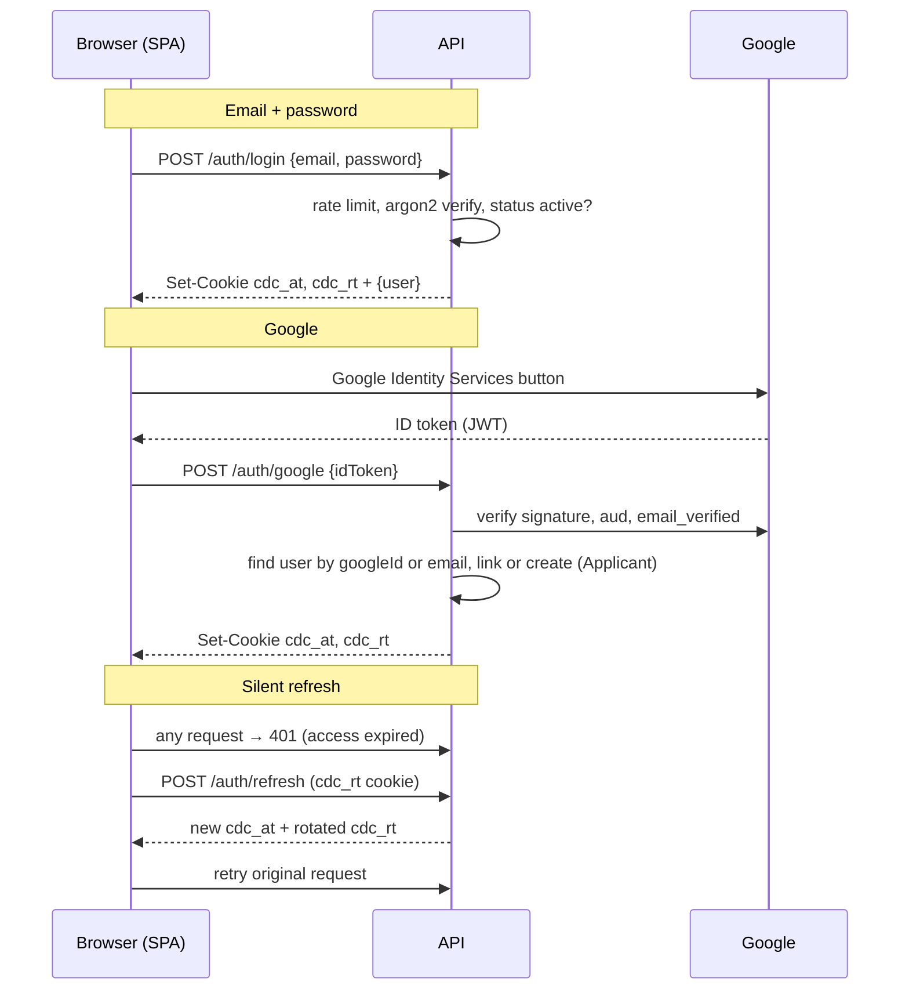

# E1 Authentication & accounts — Design

> [README](../README.md) · [requirements](requirements.md) · [design](design.md) · [tasks](tasks.md)
>
> Owns: §5, §6.2 auth endpoints. Shared design (architecture, T-xx, data model, authorization, security, testing): [core/design.md](../core/design.md). Section numbers (§) match the original DESIGN.md.

## 5. Authentication (R-07, R-08, R-12, T-10)

### 5.1 Tokens and cookies

|          | Access token                                          | Refresh token                                                                                   |
| -------- | ----------------------------------------------------- | ----------------------------------------------------------------------------------------------- |
| Format   | JWT (HS256), claims `{ sub, role, tv }`               | Random 256-bit opaque value. Only its SHA-256 hash is stored in `sessions`.                     |
| Lifetime | 15 min                                                | 30 days, rotated on every use                                                                   |
| Cookie   | `cdc_at`; `HttpOnly; Secure; SameSite=Lax; Path=/api` | `cdc_rt`; `HttpOnly; Secure; SameSite=Lax; Path=/api/v1/auth` (sent to refresh and logout only) |

- **`tv` (token version):** stored on the user. Incremented on role change, deactivation, password reset and "log out everywhere", which invalidates every outstanding access token immediately (R-13.3).
- **Refresh-token reuse detection:** if a rotated (already used) refresh token is presented, all of that user's sessions are revoked.
- Cookies are **first-party**, because the browser reaches the API through the web app's own domain (T-19). This holds on the `.vercel.app` domain and on a custom domain later (O-4).

### 5.2 CSRF

- `SameSite=Lax` already stops other sites from sending the cookies on POST/PUT/PATCH/DELETE.
- Defense in depth: state-changing requests must also carry a custom header `X-CDC-Request: 1` and an `Origin` matching the site. A cross-origin page can't add the header without a CORS preflight, and the API allows no cross-origin requests.
- axios adds the header to every request.

### 5.3 Flows

| Flow                            | Behavior                                                                                                                                                      | Requirement      |
| ------------------------------- | ------------------------------------------------------------------------------------------------------------------------------------------------------------- | ---------------- |
| Sign up (email)                 | Creates an Applicant with `emailVerified=false` and sends a verification email.                                                                               | R-07.1–2, R-08.1 |
| Sign up via invite              | `/invite/:token`: the email is fixed from the invite. Role and year are taken from the invite. The invite is marked accepted.                                 | R-07.3           |
| Registration creates an account | `POST /public/applications` creates or links a password-less Applicant user. The confirmation email includes a "set password" link (same mechanism as reset). | R-04.5           |
| Google                          | Links to an existing account when the emails match and Google says `email_verified`. Otherwise creates an Applicant.                                          | R-07.1           |
| Login failure                   | Always "האימייל או הסיסמה שגויים". Rate limit: 5 attempts / 15 min per IP+email, then HTTP 429.                                                               | R-07.4–5         |
| Verify email                    | Single-use token, 24 h. Required before any role above Applicant takes effect (acceptance waits until verified).                                              | R-08.1           |
| Password reset                  | Single-use token, 1 h, stored hashed. Bumps `tv`. Neutral response whether or not the email exists.                                                           | R-08.2           |
| Logout                          | Reads `cdc_rt`, revokes the session whose `tokenHash` matches, and clears both cookies.                                                                       | R-11.1           |

---

## 6. API design

### 6.2 Endpoints

**Auth & account**

| Method      | Path                                              | Access         | Requirements |
| ----------- | ------------------------------------------------- | -------------- | ------------ |
| POST        | `/auth/signup`                                    | Guest          | R-07         |
| POST        | `/auth/login`                                     | Guest          | R-07         |
| POST        | `/auth/google`                                    | Guest          | R-07         |
| POST        | `/auth/refresh`                                   | Refresh cookie | T-10         |
| POST        | `/auth/logout`                                    | Signed-in      | R-11         |
| POST        | `/auth/verify-email`, `/auth/resend-verification` | —              | R-08.1       |
| POST        | `/auth/forgot-password`, `/auth/reset-password`   | —              | R-08.2       |
| GET         | `/auth/me`                                        | Signed-in      | R-11         |
| GET / POST  | `/invites/:token`, `/invites/:token/accept`       | Guest          | R-07.3       |
| GET / PATCH | `/me/profile`                                     | Signed-in      | R-10         |
| POST        | `/me/photo-upload-url`                            | Signed-in      | R-10         |
